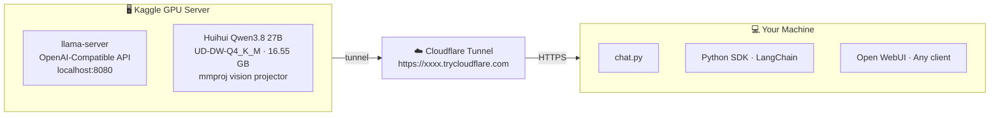

# 🧠 Free LLM Server — Huihui Qwen3.8 27B on Kaggle GPU

Run a **multimodal LLM server** (text + images) on a free Kaggle GPU and connect to it from any machine — no local GPU, no paid plan required.

> **Exact file:** `Huihui-Qwen3.8-27B-abliterated-UD-DW-Q4_K_M.gguf`
>
> **Model:** Huihui-Qwen3.8-27B-abliterated · **Quant:** UD-DW-Q4_K_M (16.55 GB) · **Backend:** llama.cpp · **Tunnel:** Cloudflare

---

The model and matching BF16 vision projector come from [huihui-ai/Huihui-Qwen3.8-27B-abliterated-GGUF](https://huggingface.co/huihui-ai/Huihui-Qwen3.8-27B-abliterated-GGUF). Both notebooks pin downloads to revision `c4b90228246aef7ecc6cb2be9d80575a911a0f3a`. The model is **16,551,316,384 bytes (15.42 GiB)**; the projector is **931,145,888 bytes (0.87 GiB)**. Together they require about **17.48 GB (16.28 GiB)** plus download metadata and other files.

The current server does **not configure API authentication**. The client value `api_key="none"` is a placeholder; anyone with the tunnel URL can send requests while it is running.

## How it works



The server exposes a standard **OpenAI-compatible API** (`/v1/chat/completions`).
Any client that works with OpenAI works here — just point it to the Cloudflare URL.

---

## Why these tools?

| Tool | Role |
|---|---|
| `llama.cpp` | Native CUDA inference, GPU layer control and separate vision projector |
| Cloudflare Tunnel | Exposes the local HTTP API through a temporary HTTPS URL |
| Kaggle | Hosts the notebook on the GPU allocation available to your account |

---

## Repository structure

```
📁 kaggle-llm-server/
├── 📓 1_setup_dataset.ipynb    ← Optional: exact Huihui files → your private Kaggle Dataset
├── 📓 1b_setup_llama.ipynb     ← Build current llama.cpp for T4 → your private Dataset
├── 📓 2_run_server.ipynb       ← Run each session: starts server + tunnel
├── 🐍 chat.py                  ← Optional: interactive CLI client with multimodal
└── 📄 README.md
```

---

## ⚡ Quick start — direct model download

This repository does not supply a prebuilt public Kaggle dataset for the selected Huihui model. Use the server's Hugging Face download path, or create your own private model dataset as described below. The previous model dataset and its publisher are not used by this setup.

1. Run **`1b_setup_llama.ipynb`** with **Internet ON** and **GPU T4** to build current llama.cpp. Set your **Kaggle username** and authenticate the Kaggle CLI as required by your account.
2. Import **`2_run_server.ipynb`** and select **GPU T4 ×2**, **Internet ON**.
3. Choose **Add Input / Add data → Your Datasets** and attach **`<your-kaggle-username>/llama-cpp-bin`** created in step 1. Select its newest version after rebuilding. No other author's public binaries are assumed compatible.
4. Leave `DOWNLOAD_IF_MISSING = True`. With no model dataset attached, the server downloads `Huihui-Qwen3.8-27B-abliterated-UD-DW-Q4_K_M.gguf` and `mmproj-model-bf16.gguf` to `/kaggle/working/huihui-qwen38-27b/` at the pinned revision. Allow about **17.48 GB** plus overhead and check free disk space.
5. Run the notebook. **Cell 2b installs CUDA 12 runtime packages** (`nvidia-cuda-runtime-cu12`, `nvidia-cublas-cu12`), locates their shared libraries and verifies loading before the binary sanity check. The library paths are retained for the server process. Copy the tunnel URL when the health check succeeds.

`KAGGLE_USERNAME` can stay empty in the **server** notebook if attached inputs are unambiguous. Setup notebooks need it to create datasets. Your Kaggle username may differ from your GitHub username.

**Rebuild current llama.cpp** when migrating from the previous setup: this server uses `--n-gpu-layers auto` and the new GGUF. The [model author recommends the latest llama.cpp](https://huggingface.co/huihui-ai/Huihui-Qwen3.8-27B-abliterated-GGUF#llamacpp). Download, compilation and loading times depend on hardware and network.

---

## Setup (one time only)

### Step 1 — Optional: create your own model dataset

1. On [Kaggle](https://www.kaggle.com/code), import `1_setup_dataset.ipynb`.
2. Set **Internet ON**; no GPU is needed for downloads.
3. Set `KAGGLE_USERNAME` in its configuration cell and ensure the Kaggle CLI is authenticated. A username alone is not authentication.
4. Run the notebook. It downloads only `Huihui-Qwen3.8-27B-abliterated-UD-DW-Q4_K_M.gguf` and `mmproj-model-bf16.gguf` from the pinned Huihui snapshot, checks their exact sizes and GGUF headers, then creates or versions **`<your-kaggle-username>/huihui-qwen38-27b-gguf`** as a private dataset.
5. In the server notebook, choose **Add Input / Add data → Your Datasets**. If searching, search **`huihui-qwen38-27b-gguf`** and select **your own dataset**. This name is the default slug generated by the setup notebook, not a claim that a public dataset already exists.

The setup downloads to `/tmp/huihui-qwen38-27b-model/` before uploading. Check available local disk space and your Kaggle dataset quota. These temporary files are not retained across sessions unless saved as a dataset.

---

### Step 2 — Compile llama.cpp

1. Create a new notebook, upload `1b_setup_llama.ipynb`
2. Settings: **Internet ON**, **GPU T4 x2**
3. Fill in your Kaggle username in Cell 1
4. Run All

This compiles current `llama-server` with CUDA for T4 (`sm_75`) and saves the binaries, shared libraries and `version.json` as **your own private `llama-cpp-bin` dataset**. Authenticate the Kaggle CLI before uploading; select the newest input dataset version after a rebuild.

> Compilation time depends on the allocated CPU/GPU environment. Rebuild when updating llama.cpp or when the Kaggle runtime changes.

---

## Running the server

Every time you want to use the LLM:

1. Open `2_run_server.ipynb` on Kaggle
2. Settings:
   - **Accelerator → GPU T4 x2** recommended
   - **Internet → ON**
   - Attach **your own `llama-cpp-bin`** dataset. Optionally attach **your own `huihui-qwen38-27b-gguf`**; otherwise the model is downloaded from Hugging Face.
3. Review the configuration cell; the server can auto-detect unambiguous attached files.
4. **Run All**
5. Wait for downloads (if needed), model loading and the health check, then find:

```
════════════════════════════════════════════════════════════
  🔗 YOUR SERVER URL
  https://xxxx.trycloudflare.com
════════════════════════════════════════════════════════════

  OpenAI endpoint : https://xxxx.trycloudflare.com/v1
  Direct answers  : python chat.py --url https://xxxx.trycloudflare.com
  Thinking mode   : python chat.py --url https://xxxx.trycloudflare.com --thinking
```

6. Copy the URL — your server is ready.

> The URL changes every session. Copy it fresh each time from the logs.

---

## Connecting your client

The server speaks the **OpenAI API protocol**. Use any compatible client:

**Open WebUI**
```
Settings → Connections → OpenAI API
URL: https://xxxx.trycloudflare.com/v1
Key: none
```

**Chatbox / LM Studio / any client**
```
API Host : https://xxxx.trycloudflare.com
Model    : huihui-qwen3.8-27b-abliterated
```

**Python (openai SDK)**
```python
from openai import OpenAI

client = OpenAI(
    base_url="https://xxxx.trycloudflare.com/v1",
    api_key="none",
)
response = client.chat.completions.create(
    model="huihui-qwen3.8-27b-abliterated",
    messages=[{"role": "user", "content": "Hello!"}],
)
print(response.choices[0].message.content)
```

**chat.py — included CLI client (text + images)**

Its default model alias is `huihui-qwen3.8-27b-abliterated`, matching the server. Use `--model` only if you change `MODEL_ALIAS`.

```bash
# Install
pip install openai

# Direct answers (fast)
python chat.py --url https://xxxx.trycloudflare.com

# Thinking mode (step-by-step reasoning, slower)
python chat.py --url https://xxxx.trycloudflare.com --thinking
```

Commands during conversation:
```
/image path/to/photo.jpg   → send an image with your next message
/clear                     → reset conversation history
/history                   → show current conversation
/exit                      → quit
```

**With an image (multimodal) — Python**

Requires `ENABLE_VISION = True` and the matching Huihui projector.

```python
import base64

with open("photo.jpg", "rb") as f:
    image_b64 = base64.b64encode(f.read()).decode()

response = client.chat.completions.create(
    model="huihui-qwen3.8-27b-abliterated",
    messages=[{
        "role": "user",
        "content": [
            {"type": "text", "text": "What's in this image?"},
            {"type": "image_url", "image_url": {"url": f"data:image/jpeg;base64,{image_b64}"}},
        ]
    }],
)
```

---

## Thinking mode

Huihui Qwen3.8 27B is a **hybrid reasoning model** — it can either answer directly or think step-by-step before answering. The CLI sends `chat_template_kwargs.enable_thinking` **per request**. No server restart is needed to switch.

### How it works

Reasoning fields and their presentation depend on the llama.cpp version and parser. `chat.py` prints streamed `delta.content`. For longer reasoning tasks, increase `--max-tokens` (the CLI default is `2048`).

The mode is passed as an extra parameter in the request body: `chat_template_kwargs`.

### With chat.py

```bash
python chat.py --url https://xxxx.trycloudflare.com             # direct
python chat.py --url https://xxxx.trycloudflare.com --thinking  # thinking
```

### With the OpenAI Python SDK

```python
from openai import OpenAI

client = OpenAI(base_url="https://xxxx.trycloudflare.com/v1", api_key="none")

# Direct mode
response = client.chat.completions.create(
    model="huihui-qwen3.8-27b-abliterated",
    messages=[{"role": "user", "content": "Your question"}],
    extra_body={"chat_template_kwargs": {"enable_thinking": False}},
    temperature=0.7,
    top_p=0.8,
)

# Thinking mode
response = client.chat.completions.create(
    model="huihui-qwen3.8-27b-abliterated",
    messages=[{"role": "user", "content": "Your question"}],
    extra_body={"chat_template_kwargs": {"enable_thinking": True}},
    temperature=1.0,   # starting value; tune for your workload
    top_p=0.95,
)
```

### With LangChain

```python
from langchain_openai import ChatOpenAI

# Direct mode
llm = ChatOpenAI(
    base_url="https://xxxx.trycloudflare.com/v1",
    api_key="none",
    model="huihui-qwen3.8-27b-abliterated",
    temperature=0.7,
    model_kwargs={
        "extra_body": {"chat_template_kwargs": {"enable_thinking": False}},
        "top_p": 0.8,
    },
)

# Thinking mode
llm_thinking = ChatOpenAI(
    base_url="https://xxxx.trycloudflare.com/v1",
    api_key="none",
    model="huihui-qwen3.8-27b-abliterated",
    temperature=1.0,
    model_kwargs={
        "extra_body": {"chat_template_kwargs": {"enable_thinking": True}},
        "top_p": 0.95,
    },
)
```

### With curl

```bash
# Direct mode
curl https://xxxx.trycloudflare.com/v1/chat/completions \
  -H "Content-Type: application/json" \
  -d '{
    "model": "huihui-qwen3.8-27b-abliterated",
    "temperature": 0.7,
    "top_p": 0.8,
    "chat_template_kwargs": {"enable_thinking": false},
    "messages": [{"role": "user", "content": "Hello!"}]
  }'

# Thinking mode
curl https://xxxx.trycloudflare.com/v1/chat/completions \
  -H "Content-Type: application/json" \
  -d '{
    "model": "huihui-qwen3.8-27b-abliterated",
    "temperature": 1.0,
    "top_p": 0.95,
    "chat_template_kwargs": {"enable_thinking": true},
    "messages": [{"role": "user", "content": "Solve this step by step..."}]
  }'
```

### Starting parameters per mode

| Parameter | Direct mode | Thinking mode |
|---|---|---|
| `temperature` | `0.7` | `1.0` |
| `top_p` | `0.8` | `0.95` |
| `enable_thinking` | `false` | `true` |

> These sampling settings are starting defaults, not validated recommendations for this Huihui quantization. Client values override server defaults.

---

## GPU, files and session lifecycle

- **T4 ×2 recommended:** the server uses `--split-mode layer`, `--parallel 1`, a 16,384-token context and `N_GPU_LAYERS="auto"` with current llama.cpp.
- **Single T4:** the weights plus projector, KV cache and compute buffers do not fit entirely in its VRAM. Use automatic or partial CPU offloading; performance will be lower. `999` requests all layers and does not guarantee fallback on allocation failure.
- **Memory tuning:** reduce `CTX_SIZE` to `8192`, reduce the GPU layer count, or set `ENABLE_VISION=False` for text-only use. No throughput measurements for this Huihui GGUF have been made by this project.
- **Attached files:** the server supports `/kaggle/input/datasets/<owner>/<slug>/` and `/kaggle/input/<slug>/`, and searches by exact filename. For duplicate matches, specify the owner/dataset or detach duplicates. Set `DOWNLOAD_IF_MISSING=False` to require input files.
- **Fresh session:** attach saved datasets, rerun the server and copy its new URL. Model downloads under `/kaggle/working/` are session-local unless saved; absent files will be downloaded again.
- **Background run:** where available, use **Save Version → Save and Run All** and inspect execution logs for the URL. The keep-alive cell monitors health; it cannot override Kaggle limits or guarantee uninterrupted service.
- **Stop:** interrupt the keep-alive cell to terminate both processes, or stop the Kaggle run.
- **Quotas:** session limits, weekly GPU allowance, storage and accelerator availability depend on your current Kaggle account allocation. Check them in Kaggle instead of relying on fixed numbers from the previous model setup.

---

## Updating llama.cpp

Re-run `1b_setup_llama.ipynb`. Cell 4 detects the existing dataset and creates a new version automatically.

---

## Troubleshooting

**`libcudart.so.12` / `libcublas.so.12` not found**

Use the updated `2_run_server.ipynb` and run **Cell 2b — Install CUDA 12 runtime dependencies** before loading/checking the binaries in Cell 3. Keep Internet ON for package installation. The cell adds NVIDIA site-package library directories and `/kaggle/working` to `LD_LIBRARY_PATH`, retains existing driver/system paths and verifies loading in a fresh subprocess. Rerun it in each fresh Kaggle session. If it fails, inspect its pip or loader error; it will not report success when required libraries are missing. This supplies the CUDA 12 user-space runtime, not a replacement GPU driver or runtime for other CUDA major versions.

**Binaries missing, unsupported flags, architecture or tensor types**

Rebuild with `1b_setup_llama.ipynb` and attach its latest dataset version. Check `version.json` and `/tmp/llama-server.log`.

**Model not found**

Attach **your own `huihui-qwen38-27b-gguf`** dataset or enable Internet and `DOWNLOAD_IF_MISSING=True`. Another quantization's filename will not match `Huihui-Qwen3.8-27B-abliterated-UD-DW-Q4_K_M.gguf`.

**Projector missing or incompatible**

Use `mmproj-model-bf16.gguf` from the same Huihui repository. Set `ENABLE_VISION=False` if you only need text.

**Out of memory / 502 from Cloudflare**

Inspect `/tmp/llama-server.log`; reduce `CTX_SIZE`, use automatic/fewer GPU layers, disable vision if unused, or select T4 ×2. The tunnel cannot recover a crashed inference process.

**Wrong model in clients**

Use `huihui-qwen3.8-27b-abliterated` or check `/v1/models`. Update old client configurations as well as the server.

**Dataset upload fails**

Check Kaggle CLI authentication, account username, storage quota and the displayed error. Never commit Kaggle API credentials.

---

## Licenses

The [Huihui model repository](https://huggingface.co/huihui-ai/Huihui-Qwen3.8-27B-abliterated-GGUF/blob/c4b90228246aef7ecc6cb2be9d80575a911a0f3a/README.md) declares **Apache-2.0** for the weights. [llama.cpp](https://github.com/ggml-org/llama.cpp/blob/master/LICENSE) is **MIT** licensed; the binary dataset uses that metadata. Project code: **MIT**, as declared by this README.
